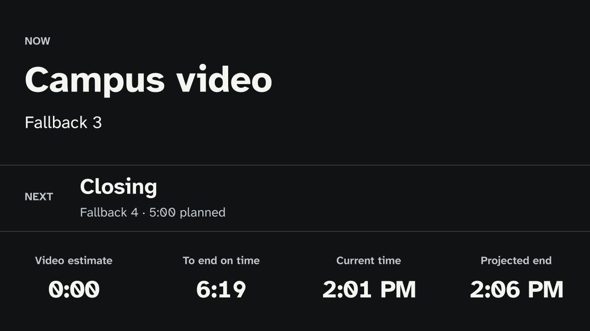

# Foldback Server

A self-hosted stage display and password-protected control panel for churches. One small Linux server runs at each campus, serving the local network and an optional directly connected TV. The display follows a fixed, readable 1920 × 1080 layout with Now, Next, notes, and four service clocks.

**Development preview:** the display, timing engine, persistent settings, Planning Center connection setup, read-only plan selection/Live synchronization, and Debian USB installer are implemented. **Real church-account validation, physical campus hardware tests and ProPresenter playback integration remain pending.** Use this release for pilot evaluation before relying on it during a gathering.

[Releases and downloads](https://github.com/CLAChurch/foldback-server/releases) · [Update and rollback guide](docs/UPDATES.md) · [Roadmap](docs/NEXT.md) · [Corporate Codex handoff](docs/CORPORATE-HANDOFF.md) · [Contributing](CONTRIBUTING.md) · [Security](SECURITY.md)



*Browser verification with invented PCO records; the video estimate holds at zero until PCO advances.*

## Features and status

| Capability | Status |
| --- | --- |
| Passworded producer panel and read-only stage display | Implemented |
| Now/Next, people/notes, countdown, end-on-time and projected finish | Implemented for sample and selected PCO services |
| Independent display updates and timing after closing the panel | Implemented |
| Durable campus settings, item starts and video overrides | Implemented |
| Per-install Planning Center OAuth/token setup and Services access test | Implemented; real church account verification pending |
| Real plan/time selection, assignments and PCO Live polling | Implemented; account-backed validation pending |
| ProPresenter playback telemetry | Planned |
| Direct TV kiosk; stop local renderer for ProPresenter mode | Implemented; physical hardware tests pending |
| Debian 13 amd64 offline USB install, BIOS and UEFI | VM tested; Secure Boot unsupported |
| Ethernet and local Wi-Fi configuration | Included; chipset compatibility must be tested |
| Manual versioned app updates, private backups and rollback | Included in 0.3.0; see update guide |

The server works independently of the Mac or Windows machine running ProPresenter. Rendering `/display` inside an actual ProPresenter stage output still needs testing on both platforms. The timing engine supports safe estimated video timing; no playback connector currently supplies actual remaining time.

## Releases

Starting with **0.4.1**, each release is prepared with two installation options: a bootable Debian 13 amd64 USB ISO for a fresh installation and a versioned application package for an existing appliance. The historical 0.2.0 installer is archived with the 0.3.0 release. Bootstrap the updater once on an existing 0.2.0 appliance using [these instructions](docs/UPDATES.md).

The tag workflow stages the application update in a GitHub draft. Maintainers build and validate the ISO from the same tag and attach it with matching sources, checksums and notices before publishing.

## Install on a mini PC

Download an ISO and its matching `ISO-SHA256SUMS` from the releases page, verify the checksum, then follow the [USB instructions](appliance/USB-INSTRUCTIONS.txt). The image includes Debian Stable main, the kernel, networking tools, and all runtime dependencies. Use an x86-64 Intel/AMD PC; 4 GB RAM, 16 GB internal storage and an 8 GB USB are recommended starting points, pending physical testing. Installation erases the selected target disk after confirmation. No full desktop is installed; a minimal X/Chromium renderer starts for direct-TV mode. Disk installation requires an explicit disk-specific erase confirmation. Installation does not require an internet download.

The server starts automatically with a unique campus hostname and TLS identity. Use the on-screen pairing code to create its control-panel password. Wi-Fi is configured locally with `sudo nmtui`; hardware requiring proprietary firmware is outside this main-only image. See [build and redistribution notes](appliance/BUILD.md) for the matching source archives and licences.

## Run from source

Requires Node.js 20.19 or newer and npm. Python 3.11+ is needed for appliance tooling/tests, not the standalone web app. The appliance uses Debian's security-maintained Node package and tests the application under it during the image build. There are no npm runtime dependencies or build step.

```sh
git clone https://github.com/CLAChurch/foldback-server.git
cd foldback-server
npm start
```

Open <http://localhost:3210/admin>. On first startup, enter the pairing code printed in the server console (also shown on the loopback TV display), then create a password of at least 12 characters. There is no default password.

Open <http://localhost:3210/display> for the TV view. Load the sample service in the control panel to exercise the clocks and video flags. All sample actions are labelled and cannot operate a real PCO plan.

After creating a campus password, setup opens the Planning Center section. Connect your church or choose **Connect later**. You can change the connection later in **Connections**. New installations contain no church credentials or preselected service type; existing campus settings are preserved.

For access from other computers on the campus LAN:

```sh
HOST=0.0.0.0 npm start
```

Use the server's actual LAN address in place of `localhost` on those devices. Both Ethernet and Wi-Fi IP connections work at the app level. The operating system must establish the network connection; this version does not configure wireless interfaces.

For encrypted LAN access, supply a certificate and key trusted by the campus devices:

```sh
FOLDBACK_TLS_CERT=/path/to/certificate.pem FOLDBACK_TLS_KEY=/path/to/key.pem HOST=0.0.0.0 npm start
```

Without these settings, development access uses HTTP. Direct HTTPS mode sets Secure session cookies. No proxy headers are trusted.

## Updates and backups

On an appliance with the updater installed:

```sh
sudo foldback-update --repository CLAChurch/foldback-server --check
sudo foldback-update --repository CLAChurch/foldback-server --install v0.4.1
sudo foldback-update --rollback
```

`--check` reports the latest published stable release. Development prereleases require an explicit tag. Commands shown here need the corresponding release to be published first. Run updates outside service time: the server and local display stop briefly and browser sessions must sign in again. There is no automatic update schedule.

The updater validates checksums and package paths, checks Node/data-schema compatibility, runs application tests as the unprivileged service user, takes a private snapshot, switches code and checks server health. Failed startup restores the old code and snapshot. A normal manual rollback retains current campus settings and tokens; `--rollback --restore-state` deliberately restores the older snapshot instead. Backups contain secrets and stay on the appliance. Debian OS/security updates remain a separate maintenance step.

See [UPDATES.md](docs/UPDATES.md) for first-time setup on the 0.2.0 image, offline packages, recovery after interruption, backups, and creating releases.

## What persists

`data/state.json` stores a salted scrypt password hash, campus settings, Planning Center credentials/tokens when configured, selected sample service, its original UTC live start, and item overrides. State changes use an atomic rename and file/directory fsync. The directory is mode 0700 and the file mode 0600. Credentials are protected by filesystem permissions, not encrypted at rest; keep backups private. Damaged state causes startup to fail instead of silently discarding a service.

Sessions expire after 12 hours, are held in memory, and require a new login after a server restart. Changing the password revokes all other sessions. Logging out or closing the control panel does not stop the server or TV view.

Environment variables: `PORT` (3210), `HOST` (127.0.0.1), `FOLDBACK_DATA_DIR` (project `data/`), `FOLDBACK_TLS_CERT`, `FOLDBACK_TLS_KEY`. The appliance also uses `FOLDBACK_CA_CERT`, `FOLDBACK_APPLIANCE=1`, and `FOLDBACK_DISPLAY_PORT=3211` for a separate, restricted loopback TV listener. That listener serves display assets/events and pairing only; admin routes are unavailable there. Planning Center secrets stay out of source control, logs, API responses, and browser display state.

## Planning Center connection setup

Use HTTPS for credential entry from another computer. Plain HTTP credential setup is only accepted from the server's own loopback address and a loopback hostname. No reverse-proxy TLS headers are trusted in this version.

**OAuth sign-in** is the default and the path for an app distributed to multiple churches. For this self-hosted implementation, each installation supplies its own registered OAuth application's Application ID and Secret. Register the exact callback URL shown in setup, then save the details and choose **Sign in with Planning Center**. The browser visits Planning Center; the app requests only the `services` scope and uses PKCE, state validation, an initiating-session check, and a separate short-lived browser-binding cookie. Tokens are stored server-side and refreshed when needed for a connection test. There is no shared developer secret bundled into the app or installer.

**Personal token · own church only** is available for an internal integration in a single Planning Center organization, with credentials belonging to that church. Enter that account's token Application ID and Secret, plus a contact email for API identification. This is not the sign-in method for a published multi-church integration.

Credentials inherit the Planning Center user's permissions. The connection test reads only `/services/v2` to verify Services access and display the organization's name. This verifies the connection, not a particular plan. Select a service separately to load its item timing and assignments; account-backed checks remain required. Authentication uses Planning Center's token endpoints; the app does not write service data or take control of Live.

Leave both credential fields blank when saving an unchanged connection. Enter both to replace it. **Remove saved connection** clears this installation's stored credentials/tokens without revoking another campus's access. To revoke provider access, use Planning Center's developer settings.

See [Planning Center's authentication guidance](https://api.planningcenteronline.com/docs/overview/authentication). Actual OAuth registration and church-account behavior have not yet been tested with a church account; automated checks use an isolated fake provider.

## Follow a Planning Center service

1. Connect your church in **Connections** and choose **Test connection**. OAuth uses the Services scope; each self-hosted installation supplies its own app registration. An internal single-church integration can use a personal token.
2. In **Choose a service to follow**, select the service type, plan and **specific service time**, then choose **Follow PCO Live**. Recent/upcoming plans are listed by default; optionally include the past year. Rehearsals and other times are not service choices.
3. Advance items, skip, backtrack and edit the running order **in Planning Center**. This app makes only GET requests to Services; it does not take control of Live. **Stop following** stops local synchronization without changing PCO and allows switching to the sample.

Live is polled about every two seconds; running-order, time and assignment snapshots refresh about every ten seconds. Timing uses the selected service's ItemTime length and original `live_start_at`, not the moment a browser or polling cycle noticed the item. Headers, pre/post-service items and items excluded from that service time never inflate later-duration sums. Edits and reorders preserve the active start and video flags; a genuine retake uses PCO's new start. Missing starts are never invented.

Direct Person assignments resolve from Services people. A TeamPosition resolves against that team and exact position name in the selected plan's scheduled roster, excluding declined times. Multiple matching scheduled people are listed rather than guessed. The selected Person-note field provides optional fallback; restricted roster access produces a producer warning. Only the selected Person-note category and resolved names enter display state, not unrelated staff notes or raw roster records.

The server continues polling after logout or closing the producer tab, and resumes the saved selection after restart. Waiting, non-service-item, other-service-time and completed states are explicit. During a network/permission failure it retains the last known item, keeps elapsed timing, marks data stale and backs off before retrying. Rate-limit headers pace requests and `Retry-After` blocks early retries. API pagination is bounded and cannot redirect credentials to another host. The integration uses Services API version `2018-11-01`.

The implementation is covered by invented API fixtures and browser checks. Actual church-account permissions, Live response shapes and position scheduling must still be verified in a non-production gathering before pilot deployment. See [the PCO operating/validation guide](docs/PCO-LIVE.md).

## Current behavior

- Landscape stage view at a fixed 1920 × 1080 reference, scaled as one canvas; locally bundled Atkinson Hyperlegible Next font under the SIL Open Font License.
- Now/Next descriptions and names, fixed clock columns, item overrun flash strictly above 10%, steady end-on-time overrun, and moving projected finish.
- Videos estimate from the original live start and hold at zero. The shared engine already rejects unrelated, ambiguous, stale, or unmapped playback signals and honors estimate-only mode. No actual playback connector is implemented yet.
- Preview highlights text overflow; it never scrolls stage content or automatically shrinks typography.
- The display receives updates independently through a read-only event stream. On server connection loss, it retains the last state, continues elapsed timing, and shows a warning. On reconnect it synchronizes with the persisted server state.
- BC Pacific time is explicitly UTC−7 year-round, independent of the browser or host's timezone. Internal timestamps remain UTC.
- On the appliance, saved output mode and connector selection are applied by a separate system service. Direct mode starts the TV renderer; ProPresenter mode stops it while the server stays available. The unprivileged web server does not execute root commands. Network preference is saved; actual Ethernet/Wi-Fi connection configuration uses the local Linux console.

## Development and verification

```sh
npm test
python3 -m unittest discover -s appliance/tests -v
python3 tools/build-update.py --allow-dirty
```

The last command creates a local test package under ignored `artifacts/update/`. Published releases must be built from committed source without `--allow-dirty`. No dependency download or frontend compilation is required.

Tests cover the brief's clock examples, video loss/reconnection and ambiguous identity, independent person resolution, durable starts/overrides, control-panel authentication, origin rejection, login throttling, session revocation, and independent display event updates. Planning Center checks cover optional setup, credential privacy, PKCE/callback binding/replay rejection, permission failures, durable refresh-token rotation, read-only catalog/selection endpoints, per-service timing, roster resolution, skips/backtracking, edits, outages, rate limits, restart and background polling. Tests use isolated temporary data directories and fake provider responses.

See [project decisions](docs/DECISIONS.md) and [integration and appliance work](docs/NEXT.md) for the remaining production work and required hardware checks.

## Project structure

| Path | Purpose |
| --- | --- |
| `src/` | HTTP server, authentication, Planning Center setup, persistent state and timing model |
| `public/` | Producer UI, stage display and bundled font |
| `test/` | Node application/integration tests using fake provider responses |
| `appliance/` | Debian image recipe, offline installer, systemd services and hardware helpers |
| `appliance/tests/` | Disk-safety and update/recovery tests |
| `tools/build-update.py` | Application update archive and manifest builder |
| `docs/` | Decisions, integration roadmap and operations guide |
| `.github/workflows/` | CI and version-tag update releases |

Contributions are welcome; read [CONTRIBUTING.md](CONTRIBUTING.md) before opening a pull request. Keep credentials, campus backups and generated VM disks out of Git and issue attachments. Please use [the security reporting guidance](SECURITY.md) for vulnerabilities.

## Licence

The original app and appliance scripts are MIT licensed; see [LICENSE](LICENSE). Debian/Linux/Chromium packages retain their individual licences, and the font retains SIL OFL 1.1. See [NOTICE](NOTICE). When sharing the release ISO, include its matching Debian source archive, app source archive, checksums, and notices. No church credentials, ProPresenter software, or Planning Center subscription are bundled.
